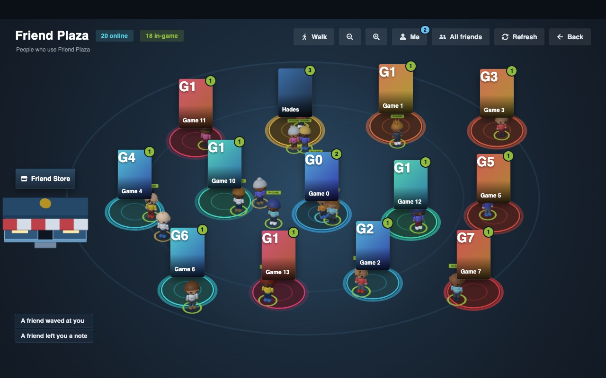
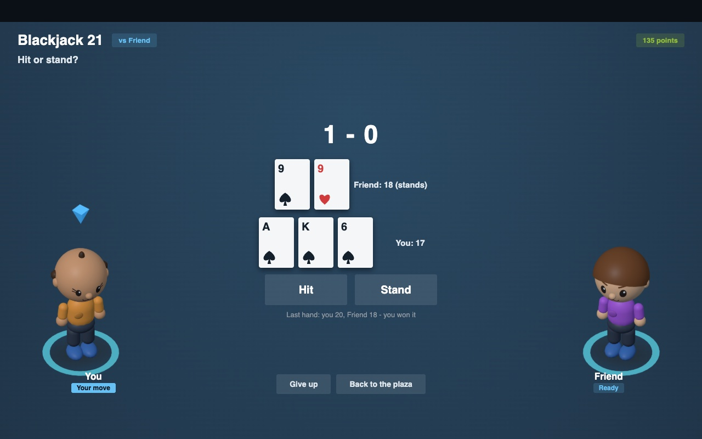
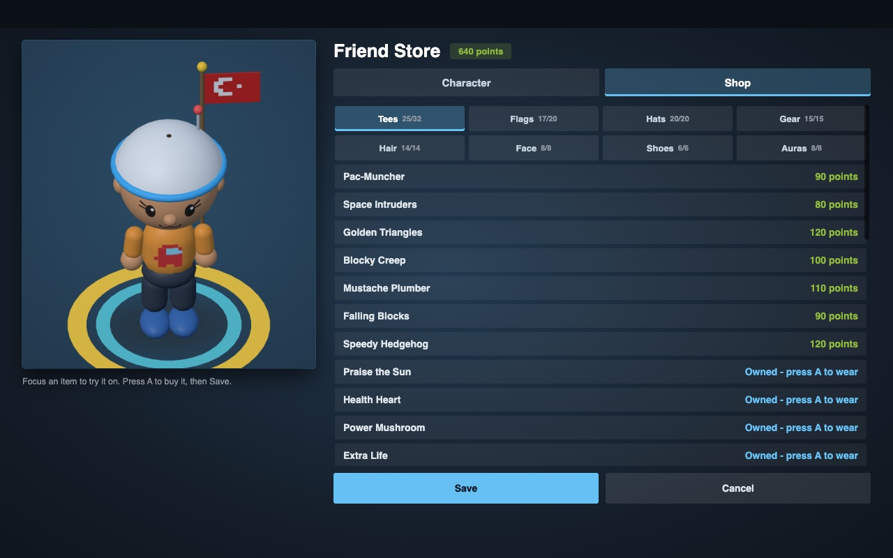
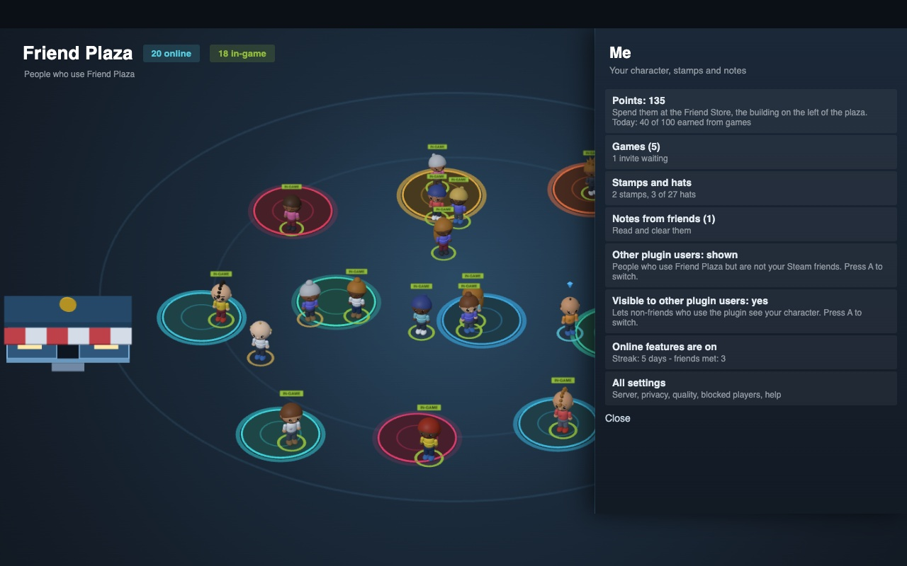

# Friend Plaza

**A little town square for you and the friends who use the same plugin. Steam Deck, Decky Loader.**



Open Friend Plaza and you see yourself and your Steam friends who also have the plugin, standing in a 3D plaza as little
characters. Everyone stands on the pad of the game they are playing right now, so you can tell at a glance who is on what.
Walk around, wave, send a note, play a quick game, earn points and spend them on how your character looks.

*Only people who use Friend Plaza appear. Steam friends who don't have it are not shown, and nothing is made up.*

## What you can do

### See who is playing what
One pad per game (up to 13), with the game's art and a count of the players. A ring shows who is in-game, online or away.
Zoom in and out, or **Walk** with your own character using the stick, D-pad or keyboard.

### Play games with a friend
Tic-Tac-Toe, Connect Four, Rock Paper Scissors and Blackjack 21. Both characters are shown on the screen while you play.
Winning (and even losing) earns points.



### Make your character yours
The **Friend Store** is a building in the plaza. Walk to the door and press A. Spend your points on more than 100 things,
tried on before you buy:



- 32 graphic tees (pixel parodies of well known games), 20 flags you carry on your back
- 27 hats, 15 pieces of gear (jetpack, katana, shield, guitar ...), 14 special hair colours
- face paint, 6 shoe styles and 8 glowing auras (one is rainbow)

### Stay in touch
Wave, send a heart, a high five, a dance, a gift hat or a short preset note. The **Me** menu keeps your points, games,
stamps, notes and settings in one place.



### Private and light
No Steam API key and no Steam password: you sign in on Steam's own page. You can hide yourself from people who are not
your friends, block and report, and delete your data from Settings. Quality adjusts by itself if the Deck gets warm.

*(Screenshots are from a desktop test version with made-up friends and games.)*

## Install
No building needed: the release already contains the built plugin.

**From GitHub (easiest):** on the Deck, open Decky > Settings > Developer > turn on Developer mode, then choose
"Install plugin from URL" and paste the link to `Friend-Plaza.zip` from the latest
[release](../../releases/latest). (Or download the zip, put it on the Deck, and use "Install plugin from ZIP file".)

**By hand:**
```
unzip Friend-Plaza.zip
sudo cp -r "Friend Plaza" ~/homebrew/plugins/ && sudo systemctl restart plugin_loader
```
The plugin comes with the address of its server built in (`server.txt`); you only change it if your group runs a different server.

## First time
Open the Friend Plaza panel in the Quick Access menu and press **Start setup**: it connects to the server, signs you in
with Steam (Steam's own login page; your password is never shared) and lets you make your first character.
Run it again any time from Settings > Help.

## Who is shown
Only people who use Friend Plaza: your Steam friends who have the plugin and, if you like, other plugin users.
Steam friends who don't use the plugin are not shown. There is no Steam API key: names, avatars and the game being
played come from the server (which reads public Steam profile pages), and the plugin reads Steam's own friend-list
file only to tell the server who your friends are. Without the server you only see yourself.

## In the plaza
- **Walk**: move your character with the stick, D-pad (diagonals work) or keyboard. A greets the friend next to you.
- **Zoom out / Zoom in**: 0.75x to 2.6x. Zoomed in, the camera follows the card or person you pick.
- **Friend Store**: the building on the left (it is solid; walk to the door and press A). Character editor and point shop.
- **Me** menu: points, games and invites, stamps and hats, notes, who you see, settings.
- When someone accepts a game you invited them to, the game opens by itself (the one who invites moves first in Tic-Tac-Toe and Connect Four).
- Only one game can be open with the same person. **Play** shows it (Continue, Accept or Cancel) instead of starting a second one.
- Pick a person: Wave, Heart, High five, Dance, Play, Gift, Note, Profile, Game, Block, Report.

## Your friend list
The plugin looks at Steam's friend-list file on every check-in (a cheap check) and reads it again as soon as Steam changes
it; the Refresh button reads it right away. How quickly a new friend shows up still depends on when Steam writes that
file, and both of you need each other in your lists.

## Settings
The Quick Access panel is only a launcher. **Settings** has everything: Steam ID, the server (address, sign in/out,
delete my data), who you see, graphics quality (Auto lowers detail by itself if the plaza stutters), blocked players,
Check setup and Save diagnostics (`~/Downloads/friend-plaza-diagnostics.txt`, no secrets).

## Troubleshooting
- Panel says it couldn't start: `tail -n 30 ~/homebrew/logs/"Friend Plaza"/*.log`, or Settings > Help > Save diagnostics.
- Nobody shows up: Settings > Help > Check setup (Steam ID, friend list, server, sign-in). Friends must have the plugin
  open and list you as a friend too.

## Code layout and tests
`main.py` is only the Decky-facing class; the logic is in `py_modules/` (fp_util, fp_net, fp_errors). The plaza page is
split into `src/plaza/` (action bar, side menu, people, camera, walking, quality, server check-ins). Tests are in
`tests/` (see `tests/README.md`).

## For developers
`dist/index.js` is committed, so users never build. To change the plugin: edit `src/`, run `pnpm i && pnpm build`,
commit `dist/`, and see `RELEASING.md`. Tests: `python3 tests/test_modules.py` and `tests/README.md`.
